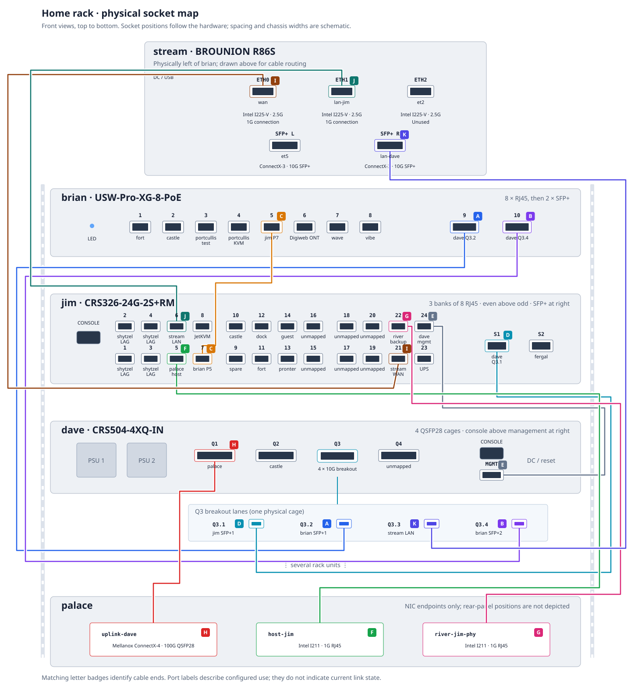

# Home switches

Reference for the home switches: MikroTik boxes `jim` and `dave`, Ubiquiti switch `brian`, and
Zyxel L2 switch `shytzel`. These switches are **not** managed by this flake; they are configured by
hand. This page covers the physical topology, VLAN map, and WAN paths.

In short: the Digiweb ISP VLAN (10) is trunked straight through to `river` (which runs PPPoE on it),
and the ONT's untagged management is PVID'd onto VLAN 140 at `brian`, its edge switch. VLAN 10 is
carried untranslated because a single ONT makes it unique on the fabric — see
[the WAN path](#the-digiweb-wan-path-trunked-vlan-10--pvid-140) and
[why not translation](#why-not-translation-for-one-ont). The router side lives in
[river.md](river.md); the logical network map in [networking.md](../../networking.md). The Wi-Fi
APs that hang off these switches are in [aps.md](aps.md). A fourth switch, **fergal**, hangs off jim
but belongs to the colony site — see [fergal](#fergal-portculliss-switch).

## The switches

| | `jim` | `dave` | `brian` | `shytzel` |
|---|---|---|---|---|
| Identity | `jim-sw` | `dave-sw` | UniFi | `shytzel` |
| Model | CRS326-24G-2S+ | CRS504-4XQ | Ubiquiti Switch Pro XG 8 PoE | Zyxel GS1920 |
| Switch chip | Marvell 98DX3236 | Marvell 98DX4310 (+ Atheros 8227 for the 100M management port) | — | — |
| OS | RouterOS 7.25.1 | RouterOS 7.25.1 | UniFi | Zyxel firmware |
| RouterBOOT | 7.25.1 | 7.25.1 | — | — |
| Ports | 24×1G + 2×SFP+ | 4×QSFP28 + 100M management | 8×10GBASE-T PoE + 2×10G SFP+ | Not recorded |
| VLAN configuration | `main`, `vlan-filtering=yes` | `main`, `vlan-filtering=yes` | UniFi VLAN profiles | 802.1Q L2; management only on `core` |

`jim` and `dave` run a single hardware-offloaded bridge (`main`) with VLAN filtering. Access to the
MikroTiks is SSH as `admin` / `admin` by short hostname (see
[Accessing the switches](#accessing-the-switches)). Only `jim` and `dave` can do hardware VLAN
translation (`/interface ethernet switch rule` on the Marvell chips); `brian` and `shytzel` provide
ordinary L2 VLAN switching.

## Physical topology

The Virgin Media modem lands on `shytzel`, which trunks VLAN 130 to `jim`; the Digiweb ONT lands on
`brian`. `brian` has its primary LAG to the `dave` core and an RSTP-protected secondary connection
to `jim`; `jim` and `dave` are also joined directly. The home boxes hang off `dave`'s high-speed
ports, with backup links to `jim`. `jim`'s second SFP+ port (`sfp-spare`, `sfp-sfpplus2`) feeds
[fergal](#fergal-portculliss-switch), which [`portcullis`](../colony/portcullis.md) hangs off while
it is staged at home.

[](diagrams/home-fabric.svg)

The [Mermaid source](diagrams/home-fabric.mmd) defines the logical topology; the rendered SVG
also works in Markdown viewers without Mermaid support.

Solid and dotted lines distinguish normal carrying paths from backup attachments; RSTP selects
ports for the whole fabric. The separate WAN connection to `stream` is outside its LAN bridge.
The 10G trunk from `jim` to [fergal](#fergal-portculliss-switch) serves the staged colony boxes.

### Front-panel port maps

In the rack, viewed from the front, the order is **`brian`, `jim`, `dave`**, with `palace` several
units below. `stream` sits to the left of `brian`; it is drawn above it to make the connections
easier to follow. The map follows each model's physical socket order: `brian` has a single RJ45 row,
`jim` has three banks with even ports above odd ports, and `dave` has four QSFP28 cages. Chassis
widths, spacing and the gap above `palace` are schematic; exact rack-unit positions are not known.
`palace`'s NICs are rear connections, shown only as endpoints rather than an invented front layout.

[](diagrams/switch-panels.svg)

Drawn lines and matching letter badges identify the two ends of a cable. Cable routes are
schematic, not a record of how the cables are dressed in the rack. NIC labels give socket
capacity; `stream`'s 2.5G copper ports connect to `jim` at 1G. Q3.1–Q3.4 are breakout lanes within
**one physical cage** on `dave`, not four separate front-panel sockets. Its management RJ45
is separate from the console above it; `jim`'s console is also separate from Ethernet port 1.

<!-- switch-cables -->
| Cable | Endpoint | Endpoint | Connection |
|---|---|---|---|
| **A** | `brian` `9` | `dave` `Q3.2` | 10G; first LAG member |
| **B** | `brian` `10` | `dave` `Q3.4` | 10G; second LAG member |
| **C** | `brian` `5` | `jim` `7` | 1G; redundant fabric trunk |
| **D** | `jim` `S1` | `dave` `Q3.1` | 10G; direct fabric trunk |
| **E** | `jim` `24` | `dave` `MGMT` | 100M; dave management |
| **F** | `jim` `5` | `palace` `host-jim` | 1G; host core / netboot |
| **G** | `jim` `22` | `palace` `river-jim-phy` | 1G; river backup trunk |
| **H** | `dave` `Q1` | `palace` `uplink-dave` | 100G; host PF and guest VFs |
| **I** | `stream` `ETH0` | `jim` `21` | 1G WAN; 2.5G socket on stream |
| **J** | `stream` `ETH1` | `jim` `6` | 1G backup LAN; 2.5G socket on stream |
| **K** | `stream` `SFP+ R` | `dave` `Q3.3` | 10G preferred LAN |
<!-- /switch-cables -->

Port labels describe configured use, not current link state. `jim` ports 1–4 are configured
members of `shytzel-downlink`; only port 1 had an active link at inspection. `brian` port 3 is
reserved for testing `portcullis`, and port 4 serves its second JetKVM.

The panel layouts reference the manufacturers' [Pro XG 8 PoE guide](https://dl.ui.com/qig/usw-pro-xg-8-poe/),
[CRS326-24G-2S+RM panel](https://mikrotik.com/product/CRS326-24G-2SplusRM),
[CRS504-4XQ-IN panel](https://mikrotik.com/product/crs504_4xq_in), and
[R86S panel photograph](https://www.gowinfanless.com/news/blogs/the-r86s-revolution-low-power-2-5gbe-and-10gbe-networking).
`stream`'s connected SFP+ socket is the right-hand one, confirmed physically; the left is unused.
Its copper socket mapping is inferred from PCI order and sequential permanent MACs. The SFP+
sockets are labelled left/right in the drawing because both carry the same printed label.
Port use comes from RouterOS interface/bonding configuration, LLDP, the UniFi controller and
physical connection confirmation.
The editable inventory is [switch-ports.json](diagrams/switch-ports.json); run
`python3 docs/sites/home/diagrams/render-switch-panels.py` to regenerate the SVG and cable table.


Notes:
- **river** uses `palace`'s 100G connection to `dave` and the dedicated 1G `river-jim-phy`
  connection to `jim`. The separate `host-jim` connection serves host management and VM netboot.
  See [palace's networking](palace.md#networking) for the handoffs and
  [failover validation](router-failover.md) for tested failure scenarios.
- `jim`'s `palace-kvm` port is a JetKVM connection, not either of `palace`'s network attachments.
- **stream** (the second router box) is dual-homed to both jim and dave (STP picks the active path).
- The `brian`–`jim` secondary connection provides the redundant Digiweb path. VLANs 10 and 140 are
  tagged on `brian-downlink` and `river`, keeping the ONT reachable without `dave`.

### `castle` storage dependency

`castle` is dual-homed without STP: its primary link is dave's 100G `castle` port (`et100g`), while
the backup NIC (`et2.5g`) connects at 1G to jim and is normally down, providing no live failover.
Its root disk is NVMe-oF over `et100g` and dave, so interrupting either freezes `castle` mid-I/O.
Do dave maintenance from a box that does not depend on it, or power `castle` off cleanly first.

## VLANs

| VLAN | Name | Purpose |
|---|---|---|
| — (native) | core | Switch management, `192.168.64.0/24` (`jim` `.10`, `dave` `.11`, `shytzel` `.12`, `brian` `.13`) |
| 100 | hi | High-performance / jumbo network (MTU 9000) |
| 110 | lo | Standard LAN |
| 120 | untrusted | Guest / untrusted network |
| 130 | wan | `stream`'s WAN — tagged from `shytzel`, untagged on `jim`'s `stream-wan` |
| 140 | wan-pon-ont | ONT management, `192.168.100.0/24` (PVID'd at the ONT edge) |
| 10 | pon-isp | Digiweb ISP transport — **trunked straight through** to river, PPPoE runs on it |
| 141 | wan-pon-isp | **Reserved** — the translated ISP VLAN for the future multi-ONT design |

Switch L3 presence (`/interface vlan` on `main`) exists **only** for VLANs the switch is managed
from — `hi` (100) and `lo` (110), plus native core. WAN and guest VLANs deliberately have no switch
L3 interface. jim and dave carry a static IPv4 and **global IPv6** address on `hi`/`lo` (plus a
static default route on each stack) purely for management — they are **pure L2, never routers**. See
[Switches must not route](#switches-must-not-route).

## The Digiweb WAN path (trunked VLAN 10 + PVID 140)

The ONT presents two things on one wire:
- **untagged** management traffic (`192.168.100.x`), and
- **tagged VLAN 10** carrying the Digiweb ISP session (the BRAS requires VLAN 10).

With a **single ONT** there's no reason to translate anything — VLAN 10 is unique on the fabric, so
we just carry it end to end and let river run PPPoE directly on it:

1. **Untagged mgmt → VLAN 140, at the ONT's edge switch (brian).** brian sets the ONT port's PVID to
   140 so the untagged management traffic becomes VLAN 140, and allows tagged VLAN 10 through the
   same port. river takes `192.168.100.100/24` on VLAN 140 (matching stream's modem-mgmt `.100`) to
   reach the ONT web UI at `192.168.100.1`. Doing the PVID at the ONT-facing edge keeps it clean —
   the untagged frames never share a domain with anything else.

2. **VLAN 10 (ISP) trunked straight through, untranslated.** The primary path is
   brian → dave → palace; the RSTP-protected secondary path reaches jim before returning to the
   router attachment. Both carry tagged VLAN 10 by ordinary bridge-VLAN membership. No
   `/interface ethernet switch rule`, no pinning, no asymmetric-learning issues — it's just a
   normal tagged VLAN. river attaches PPPoE to VLAN 10 directly (`wan-pon-isp` netdev = VLAN
   `pon-isp` = 10; baby-jumbo MTU 1508 so PPP nets a clean 1500).

Net result: **river runs PPPoE single-tagged on VLAN 10 and holds a VLAN 140 address to reach the
ONT.** See [`nixos/boxes/home/palace/vms/river.nix`](../../../nixos/boxes/home/palace/vms/river.nix)
for the river side.

```
ONT -- untagged + VLAN 10 -- brian -- VLAN 140 + VLAN 10 -- dave -- palace -- river
                              |
                              +-- ONT port PVID 140; VLAN 10 remains tagged
```

### Why not translation (for one ONT)?

Translation would swap VLAN 10 → 141 with two pinned hardware ACL rules to keep VLAN 10 off the rest
of the fabric. That buys nothing with a single ONT — VLAN 10 is already unique, so trunking it is
simpler and rule-free. Translation only earns its keep when **two** ONTs both deliver VLAN 10 and
would collide (below).

## Switch configuration

How each switch is set up for the Digiweb WAN path. **Confirm any change on the box before applying**
(see [Accessing the switches](#accessing-the-switches)).

**brian (UniFi)** — hosts the ONT:
- The ONT port has **native/untagged network = VLAN 140** (PVID) and is a **tagged member of VLAN 10**,
  so the ONT's untagged management lands on 140 and its tagged ISP frames pass through.
- The `brian-downlink` LAG up to dave trunks **tagged 140 + tagged 10** (alongside the LAN VLANs).
- Its secondary connection to jim carries the same relevant VLANs and participates in RSTP, so it
  normally remains blocked while the primary path is healthy.

**dave (RouterOS)** — trunks both WAN-pon VLANs to `brian-downlink` and `palace`. The ISP VLAN 10 row:
```
/interface bridge vlan add bridge=main vlan-ids=10 tagged=brian-downlink,palace,jim-downlink
```
VLAN 140 also spans `brian-downlink,palace,jim-downlink` (it carries a few other members too).
The direct connection to `jim` must carry both VLANs: if only `palace`'s `dave` connection fails,
the surviving RSTP path from `river` through `jim` can still traverse `dave` to reach `brian`.
These are ordinary tagged VLANs with no switch rules.

**jim (RouterOS)** — the physical `brian-downlink` is the RSTP-protected secondary connection from
`brian`. VLANs 10 and 140 have `brian-downlink`, `river` and `dave-uplink` as tagged members; no
translation rules are involved. RSTP selects one tree for the bridge, so VLAN membership must
include the surviving paths through `dave` as well as the direct backup connection to `brian`.
The `river` port is native `core` with VLANs 10, 100, 110, 120 and 140 tagged. It
faces `palace`'s `river-jim-phy`; `palace-kvm` is the separate JetKVM connection and must remain
unchanged. See [failover validation](router-failover.md) for attachment and switch-outage checks.

Other connections on `jim`:

| Interface | Connection |
|---|---|
| `ether9` | Disconnected, unbridged spare |
| `stream-wan` | Dedicated untagged VLAN 130 handoff to `stream` `wan` |
| `river` | `river-jim-phy`, redundant native-core trunk |

The modem connects to `shytzel`. `stream` has two distinct connections to `jim`: `stream-wan`
for its isolated WAN handoff and `stream` for the `lan-jim` RSTP trunk. VLAN 130 has
`shytzel-downlink` tagged and only `stream-wan` untagged.

`sfp-spare` (`sfp-sfpplus2`) stays at `pvid=1`—the switch feeding `portcullis` is reached over
VLAN 1 untagged—and is a tagged member of `hi` (100) and `lo` (110):

```
/interface bridge vlan set [find bridge=main vlan-ids=100] tagged=...,sfp-spare
/interface bridge vlan set [find bridge=main vlan-ids=110] tagged=...,sfp-spare
```

## Switches must not route

jim and dave (and the `vibe` AP) are **pure L2** — river/stream do all routing. Their per-stack
management addresses and static default routes exist only so the boxes themselves can be reached and
reach out; they must **never** forward traffic or advertise themselves as routers. RouterOS defaults
work against this: `ip-forward` and IPv6 `forward` ship **on**, and with IPv6 forwarding on RouterOS
also emits Router Advertisements (`ra-lifetime=30m`) on every L3 interface — so a switch silently
becomes a competing IPv6 default router.

The required config on each RouterOS box:
```
/ip settings set ip-forward=no
/ipv6 settings set forward=no accept-router-advertisements=no
/ipv6 nd set [find] ra-lifetime=0
```
- `ip-forward=no` / `forward=no` — no L3 forwarding on either stack; IPv6 `forward=no` also stops RA
  emission at the source.
- `accept-router-advertisements=no` — with forwarding off RouterOS would otherwise start *accepting*
  RAs; this keeps the box on its deterministic **static** default route.
- `ra-lifetime=0` — belt-and-suspenders: even if forwarding is ever re-enabled the box advertises
  router-lifetime 0 (i.e. "not a default router"). Setting it also emits a withdrawal RA that
  actively clears the rogue default from clients (they otherwise cache it for up to ~30 min).

**After any RouterOS upgrade, re-check `/ip settings` and `/ipv6 settings`** — an upgrade can reset
these to the forwarding-on defaults. `brian` uses UniFi and does not have these RouterOS settings.

## Future: multiple ONTs (per-port VLAN translation)

If a second ONT arrives (e.g. a Digiweb line for stream, or a second river), trunking breaks: both
ONTs deliver **tagged VLAN 10**, and plain bridge-VLAN filtering can't tell them apart. That's when
translation earns its place — a switch rule matches on the **ingress port**, so each ONT's VLAN 10
becomes a *distinct* fabric VLAN:

- ONT-A port: VLAN 10 → **141** (→ river)
- ONT-B port: VLAN 10 → **142** (→ stream / second river)
- mgmt: PVID each ONT port onto its own VLAN (140, 143, …) so both ONTs' `192.168.100.1` stay in
  separate L2/L3 domains.

The forward direction isolates naturally (each ONT maps to a different fabric VLAN). The **return**
direction is where port targeting is mandatory: both translate *back* to VLAN 10, so bridge VLAN 10
now has two members and a plain FDB-miss flood would leak one ONT's upstream to the other. Each
return must be pinned to its port with `new-dst-ports`:
```
# ONT-A: 141 in on palace → 10, forced out ONT-A's port
# ONT-B: 142 in on stream → 10, forced out ONT-B's port
```
Each ONT port must also be a tagged member of bridge VLAN 10 for correct egress tagging (the missing
piece that otherwise shows up as pppd "Timeout waiting for PADO"). The pins bypass the FDB, so the
two ISP sessions never mix.

**Why a new switch:** jim (the only box with spare SFP+ *and* the translation feature) had just
**one** free SFP+ port — now taken by fergal — so it can't host two ONTs. The plan is a dedicated
**CRS305-1G-4S+** (4×SFP+, same Marvell rule support) to land multiple ONTs and do the per-port
translation there, feeding distinct fabric VLANs up to dave.

## fergal (portcullis's switch)

**fergal** is an 8-port SFP+ switch running OpenWrt, hanging off jim's `sfp-spare` port. It belongs
to [`portcullis`](../colony/portcullis.md) rather than to the home fabric — it is here only while
that box is staged at home, and goes to Nikhef with it. Nothing in the home fabric depends on it.

What it borrows from home is VLAN 1 untagged on the jim uplink (fergal's own management sits on it,
at `192.168.64.30` on core) plus tagged `hi` (100) and `lo` (110), so `portcullis` can reach those
over 10G. The switch itself — VLAN layout, flash layout, firmware and flashing notes — is
documented in [sites/colony/fergal.md](../colony/fergal.md).

## Accessing the switches

### Upgrades

Save a text export and an encrypted binary backup, and download both before rebooting. Local
upgrade backups are kept outside Git under `.cache/mikrotik/<date>/`; the backup password is
stored alongside them with restricted permissions. Binary backups are intended for restoration
on the same box and RouterOS version.

Upgrade one switch at a time. Upgrade `dave` while `jim` carries the backup path, verify its
return, then upgrade `jim`. Check RouterOS packages first, then upgrade RouterBOOT and reboot
again if its running version differs. After each upgrade, verify bridge VLAN membership, RSTP
roles, hardware offload and the [forwarding/RA settings](#switches-must-not-route).

During failover, use bounded SSH calls and an explicit IPv4 management address where useful.
RouterOS parses newlines in SSH command strings separately: send a multi-statement block as one
line with semicolons so local variables and braces retain their scope.

Whole-switch outage behavior is covered by the
[validated scenarios](router-failover.md#validated-scenarios).

RouterOS uses Ed25519 host keys by default. Upgrading an older installation can change the
host-key type from RSA; verify the box's identity independently before updating the client's
`known_hosts` entry.

### SSH

The switches resolve by **short hostname** on the home network — the home routers serve their
records in the home zone
([`nixos/boxes/home/routing-common/dns.nix`](../../../nixos/boxes/home/routing-common/dns.nix):
`jim` → hi `.10`, `dave` → hi `.11`, `brian` → core `.13`). From a box on the home network just
`ssh admin@jim` / `admin@dave`.

**Key auth** for `admin` is installed on jim/dave (and the `vibe` AP) — `ssh -i ~/.ssh/id_rsa
admin@jim` works keyless (imported via `/user ssh-keys import`). Password `admin`/`admin` remains as
a fallback. Non-interactive password pattern (avoids the ssh-agent hang) if the key isn't available:

```
sshpass -p admin ssh -o IdentityAgent=none -o PubkeyAuthentication=no \
  -o PreferredAuthentications=password -o StrictHostKeyChecking=accept-new \
  -o UserKnownHostsFile=/tmp/sw_known_hosts admin@jim
```

**Always confirm config changes on the switch** (print the affected menu, apply, re-verify).
`brian` is configured through its UniFi controller. `shytzel` is an L2 managed switch whose
management interface is reachable only through `core`.

## Management IPs

| | core (`192.168.64.0/24`) | hi (`192.168.68.0/22`) | lo (`192.168.72.0/21`) |
|---|---|---|---|
| `jim` | `.10` (on `main`) | `.10` | `.10` |
| `dave` | `.11` (on `management`, the 1G Atheros port) | `.11` | `.11` |
| `brian` | `.13` (`core`) | — | — |
| `shytzel` | `.12` | — | — |
